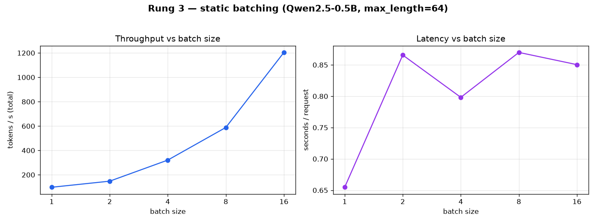

# Learning-Inference-Optimization

A from-scratch climb through LLM inference optimization: build each primitive by
hand, benchmark it, and only then read the papers that optimize it. The full
ladder is in [plan.md](plan.md); progress is tracked in [PROGRESS.md](PROGRESS.md).

The app is a small FastAPI server (`main.py` + `app/`) that loads a HuggingFace
causal LM and exposes generation endpoints. Each rung of the plan changes the
serving internals; the benchmark below measures the effect.

## Endpoints

| Method | Path | Purpose |
|--------|------|---------|
| POST | `/load?model_name=…` | Load a model into memory |
| POST | `/unload?model_name=…` | Free a loaded model |
| GET  | `/models` | List loaded models |
| POST | `/generate?model_name=…&input_text=…&max_length=…` | One-shot generation |
| POST | `/generate-stream?model_name=…&input_text=…&max_length=…` | Token-by-token SSE stream |

## Setup

```bash
uv venv .venv
source .venv/bin/activate
uv sync
```

> **Hardware note:** dev GPU is ~8 GB. Use a small softmax-attention model
> (`Qwen/Qwen2.5-0.5B`, `gpt2`). Avoid 2B / linear-attention models — they don't
> fit and don't have a classic growing KV cache.

## Run

```bash
python main.py            # serves on http://localhost:8000
```

## Benchmarking

`scripts/benchmark_endpoint.py` drives `/generate-stream` in a closed-loop
concurrency sweep and reports the metrics that matter for interactive serving —
**TTFT** (time to first token), **TPOT** (time per output token), token
throughput, and tail latency.

```bash
# server in one terminal, then:
python scripts/benchmark_endpoint.py --model Qwen/Qwen2.5-0.5B --load --levels 1,2,4,8,16
```

Turn a result file into the 4-panel plot shown below:

```bash
python scripts/plot_endpoint.py \
    --results benchmarks/rung2_kv_cache.json \
    --out benchmarks/rung2_kv_cache.png \
    --title "Rung 2 — KV cache (Qwen2.5-0.5B)"
```

### Workflow after each rung

1. Run the benchmark, archiving the result: `--out` it, then
   `cp bench_endpoint_results.json benchmarks/rung<N>_<name>.json`.
2. Plot it to `benchmarks/rung<N>_<name>.png`.
3. Tick the rung in [PROGRESS.md](PROGRESS.md) and add the plot below.

## Benchmarks

### Rung 2 — KV cache

Qwen2.5-0.5B, `max_length=64`, closed-loop sweep over concurrency 1–16.


**Takeaways:** TTFT drops to ~23 ms (a single prefill pass) and TPOT is a real
~18 ms/token at concurrency 1 — the cache is doing exactly one token's work per
step. Throughput stays ~60–83 tok/s across all concurrency levels and latency
scales roughly linearly: requests serialize on one GIL-bound forward pass with no
batching. Bending that flat throughput line upward is the job of **rung 3**.

### Rung 3 — static batching

Qwen2.5-0.5B, `max_length=64`, one `/generate-batch` request per batch size (sweep 1–16).

```bash
python scripts/benchmark_batch.py --model Qwen/Qwen2.5-0.5B --load --batch-sizes 1,2,4,8,16,32
cp bench_batch_results.json benchmarks/rung3_batching.json
python scripts/plot_batch.py --results benchmarks/rung3_batching.json \
    --out benchmarks/rung3_batching.png --title "Rung 3 — static batching (Qwen2.5-0.5B)"
```



**Takeaways:** total throughput climbs ~12× (98 → 1204 tok/s) from batch 1 → 16
while per-request latency stays ~0.8s — the memory-bandwidth amortization the plan
is about: load the weights once, reuse them across many sequences. Per-sequence
tok/s settles around ~72–77 (the price of sharing a batch). Batch 32 OOMs the
~8 GB card (0.5B weights + 32 KV caches).
