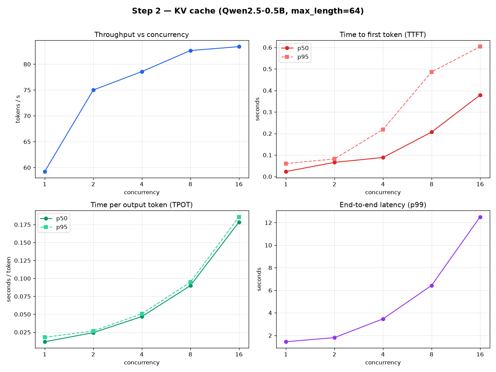
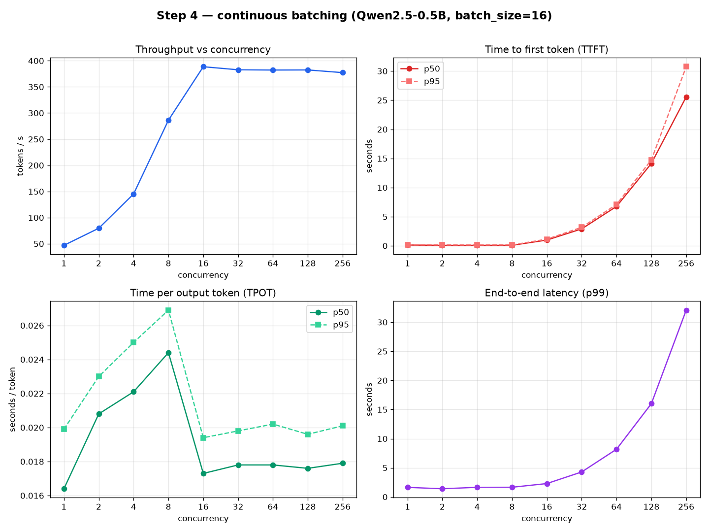

# Learning-Inference-Optimization

A from-scratch climb through LLM inference optimization: build each primitive by
hand, benchmark it, and only then read the papers that optimize it. The full
ladder is in [plan.md](plan.md); progress is tracked in [PROGRESS.md](PROGRESS.md).

The app is a small FastAPI server (`main.py` + `app/`) that loads a HuggingFace
causal LM and exposes generation endpoints. Each build step of the plan changes the
serving internals; the benchmark below measures the effect.

## Endpoints

| Method | Path | Purpose |
|--------|------|---------|
| POST | `/load?model_name=…` | Load a model into memory |
| POST | `/unload?model_name=…` | Free a loaded model |
| GET  | `/models` | List loaded models |
| POST | `/generate?model_name=…&input_text=…&max_length=…` | One-shot generation |
| POST | `/generate-stream?model_name=…&input_text=…&max_length=…` | Token-by-token SSE stream |

## Setup

```bash
uv venv .venv
source .venv/bin/activate
uv sync
```

> **Hardware note:** dev GPU is ~8 GB. Use a small softmax-attention model
> (`Qwen/Qwen2.5-0.5B`, `gpt2`). Avoid 2B / linear-attention models — they don't
> fit and don't have a classic growing KV cache.

## Run

```bash
python main.py            # serves on http://localhost:8000
```

## Benchmarking

`scripts/benchmark_endpoint.py` drives `/generate-stream` in a closed-loop
concurrency sweep and reports the metrics that matter for interactive serving —
**TTFT** (time to first token), **TPOT** (time per output token), token
throughput, and tail latency.

```bash
# server in one terminal, then:
python scripts/benchmark_endpoint.py --model Qwen/Qwen2.5-0.5B --load --levels 1,2,4,8,16
```

Turn a result file into the 4-panel plot shown below:

```bash
python scripts/plot_endpoint.py \
    --results benchmarks/step2_kv_cache.json \
    --out benchmarks/step2_kv_cache.png \
    --title "Step 2 — KV cache (Qwen2.5-0.5B)"
```

### Workflow after each step

1. Run the benchmark, archiving the result: `cp bench_*_results.json benchmarks/step<N>_<name>.json`.
2. Plot it to `benchmarks/step<N>_<name>.png`.
3. Register it on the board and refresh the cross-step comparison:
   ```bash
   python scripts/board.py add --step <N> --label "Step <N> — <name>" \
       --results benchmarks/step<N>_<name>.json
   python scripts/board.py compare --out benchmarks/step_comparison.png
   ```
4. Tick the step in [PROGRESS.md](PROGRESS.md) and add the plot below.

### Cross-step comparison

`scripts/board.py` keeps a persistent board (`benchmarks/board.json`) that every
step registers into; `compare` plots whatever's on it (throughput + latency), so
new steps show up automatically. N is concurrency for steps 2 & 4, batch size for step 3:


The apples-to-apples comparison is **step 2 vs step 4** (both sweep live concurrency).
Step 2 (per-request) stays flat (~86 tok/s) and its p99 latency explodes to ~12s under
load. **Step 4 (continuous batching) climbs to ~389 tok/s and saturates at the
`batch_size=16` knee**, with TPOT flat across the whole sweep — same live concurrency,
batched forward passes. Step 3 (static batching) climbs highest (~1200 tok/s)
but it isn't directly comparable: its N is *batch size* in a single offline request (perfect
packing, no scheduling), i.e. the throughput ceiling, whereas step 4 is what you actually get
serving independent live requests (and is currently capped by the engine's `batch_size`).

## Benchmarks

### Step 2 — KV cache

Qwen2.5-0.5B, `max_length=64`, closed-loop sweep over concurrency 1–16.



**Takeaways:** TTFT drops to ~23 ms (a single prefill pass) and TPOT is a real
~18 ms/token at concurrency 1 — the cache is doing exactly one token's work per
step. Throughput stays ~60–83 tok/s across all concurrency levels and latency
scales roughly linearly: requests serialize on one GIL-bound forward pass with no
batching. Bending that flat throughput line upward is the job of **static batching**.

### Step 3 — static batching

Qwen2.5-0.5B, `max_length=64`, one `/generate-batch` request per batch size (sweep 1–16).

```bash
python scripts/benchmark_batch.py --model Qwen/Qwen2.5-0.5B --load --batch-sizes 1,2,4,8,16,32
cp bench_batch_results.json benchmarks/step3_batching.json
python scripts/plot_batch.py --results benchmarks/step3_batching.json \
    --out benchmarks/step3_batching.png --title "Step 3 — static batching (Qwen2.5-0.5B)"
```


**Takeaways:** total throughput climbs ~12× (98 → 1204 tok/s) from batch 1 → 16
while per-request latency stays ~0.8s — the memory-bandwidth amortization the plan
is about: load the weights once, reuse them across many sequences. Per-sequence
tok/s settles around ~72–77 (the price of sharing a batch). Batch 32 OOMs the
~8 GB card (0.5B weights + 32 KV caches).

### Step 4 — continuous batching

One background engine (`app/batching/engine.py`) merges live in-flight requests into a
rolling batch. Concurrency sweep against `/generate-continuous-batch`:

```bash
python scripts/benchmark_endpoint.py --model Qwen/Qwen2.5-0.5B --load \
    --endpoint generate-continuous-batch
cp bench_endpoint_results.json benchmarks/step4_continuous_batching.json
python scripts/plot_endpoint.py --results benchmarks/step4_continuous_batching.json \
    --out benchmarks/step4_continuous_batching.png --title "Step 4 — continuous batching (Qwen2.5-0.5B)"
```



**Takeaways:** the canonical serving curve. Throughput **climbs to the knee at concurrency =
`batch_size` (16), reaching ~389 tok/s, then saturates flat (~383)** as the GPU is fully fed.
**TPOT stays ~0.02s across the whole sweep (conc 1 → 256)** — constant per-token cost once a
request is batched, vs step 2's 14× blow-up. TTFT is ~0.08s until the knee, then grows linearly
(→25s at conc 256) as requests queue for a slot. So past the knee you buy only latency, not
throughput — the SLO operating point is ≈ the knee. (At concurrency 1, CB is slightly slower
than step 2: engine overhead with no batch to amortize.)
