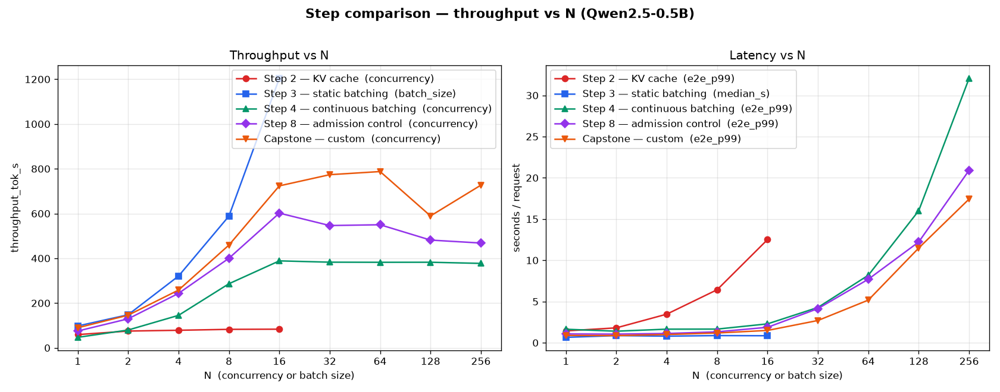

# Learning-Inference-Optimization

> A from-scratch climb through LLM inference optimization: build each primitive by
> hand, benchmark it, and only then read the papers that optimize it.

The app is a small FastAPI server (`main.py` + `app/`) that loads a HuggingFace causal LM
and exposes generation endpoints. Each step of the [ladder](plan.md) changes the serving
internals; a persistent benchmark board measures the effect. The whole point is to make a
production system's design decisions *legible* — by having built a server without them first.

## Highlights

- **A continuous-batching inference server, built from scratch** — KV cache, static batching,
  a background in-flight batching engine (scheduler + per-request streaming queues), admission
  control with graceful load-shedding, and KV **cache surgery** (splice on admit, slice on evict).
- **~788 tok/s on a single ~8 GB GPU** (Qwen2.5-0.5B): throughput climbs to the batch knee, TPOT
  stays flat at ~0.02 s/token across the whole sweep, and load past capacity is shed as clean
  HTTP 429s — **0 errors through concurrency 64**.
- **Benchmarked head-to-head against vLLM: ~12× off peak throughput** — and every piece of that
  gap maps to a specific technique this project deliberately deferred to a read/interview track
  (PagedAttention, fused kernels, CUDA graphs).

Full ladder and status: **[plan.md](plan.md)** · detailed per-step notes and bug trails:
**[PROGRESS.md](PROGRESS.md)**.

## Quickstart

```bash
uv venv .venv
source .venv/bin/activate
uv sync

python main.py            # serves on http://localhost:8000
```

> **Hardware note:** dev GPU is ~8 GB. Use a small softmax-attention model
> (`Qwen/Qwen2.5-0.5B`, `gpt2`). Avoid 2B / linear-attention models — they don't
> fit and don't have a classic growing KV cache.

## The climb

Every benchmark below uses **Qwen2.5-0.5B**, `max_length=64`, driven **closed-loop** (each client
fires its next request the instant the last finishes) while sweeping concurrency. Four metrics
matter for interactive serving:

- **TTFT** — time to first token (responsiveness)
- **TPOT** — time per output token (streaming smoothness)
- **throughput** — total tok/s across all requests
- **tail latency** — p95 / p99 end-to-end

### Cross-step comparison

`scripts/board.py` keeps a persistent board (`benchmarks/board.json`) that every step registers
into; `compare` plots whatever's on it, so new steps show up automatically. N is concurrency for
steps 2, 4 & 8, and batch size for step 3.



The apples-to-apples comparison is **step 2 vs step 4** (both sweep live concurrency).
Step 2 (per-request) stays flat (~86 tok/s) and its p99 latency explodes to ~12s under
load. **Step 4 (continuous batching) climbs to ~389 tok/s and saturates at the
`batch_size=16` knee**, with TPOT flat across the whole sweep — same live concurrency,
batched forward passes. Step 3 (static batching) climbs highest (~1200 tok/s)
but it isn't directly comparable: its N is *batch size* in a single offline request (perfect
packing, no scheduling), i.e. the throughput ceiling, whereas step 4 is what you actually get
serving independent live requests (and is currently capped by the engine's `batch_size`).
The **Capstone — custom** curve on the board is the same engine after the cache-surgery + `no_grad`
fixes: it climbs to **~788 tok/s** on the live-concurrency sweep, well above the original step-4 build.

### Step 1 — baseline

A naive per-request forward pass with no KV cache, no batching, and no engine: each request is a
full prefill + decode over the whole sequence every step. `/generate` doesn't stream, so
TTFT = TPOT = total latency / total tokens. This is the flat line every later step bends upward.

### Step 2 — KV cache

`/generate-stream`, closed-loop sweep over concurrency 1–16.


**Takeaways:** TTFT drops to ~23 ms (a single prefill pass) and TPOT is a real
~18 ms/token at concurrency 1 — the cache is doing exactly one token's work per
step. Throughput stays ~60–83 tok/s across all concurrency levels and latency
scales roughly linearly: requests serialize on one GIL-bound forward pass with no
batching. Bending that flat throughput line upward is the job of **static batching**.

### Step 3 — static batching

`/generate-batch` — N prompts in one offline request (sweep batch size 1–32).


**Takeaways:** total throughput climbs ~12× (98 → 1204 tok/s) from batch 1 → 16
while per-request latency stays ~0.8s — the memory-bandwidth amortization the plan
is about: load the weights once, reuse them across many sequences. Per-sequence
tok/s settles around ~72–77 (the price of sharing a batch). Batch 32 OOMs the
~8 GB card (0.5B weights + 32 KV caches).

### Step 4 — continuous batching

One background engine (`app/batching/engine.py`) merges live in-flight requests into a rolling
batch. Concurrency sweep against `/generate-continuous-batch`.


**Takeaways:** the canonical serving curve. Throughput **climbs to the knee at concurrency =
`batch_size` (16), reaching ~389 tok/s, then saturates flat (~383)** as the GPU is fully fed.
**TPOT stays ~0.02s across the whole sweep (conc 1 → 256)** — constant per-token cost once a
request is batched, vs step 2's 14× blow-up. TTFT is ~0.08s until the knee, then grows linearly
(→25s at conc 256) as requests queue for a slot. So past the knee you buy only latency, not
throughput — the SLO operating point is ≈ the knee. (At concurrency 1, CB is slightly slower
than step 2: engine overhead with no batch to amortize.)

> This plot is the original **recompute-on-rebatch** build. The engine was later upgraded to KV
> **cache surgery** + a `torch.no_grad()` serving path — the post-fix curve is in the next section.

### Cache surgery + `no_grad` — the post-fix engine

Two changes turned step 4 from "works but leaks and re-prefills" into a stable engine:

- **KV cache surgery** replaces recompute-on-rebatch. On admit, only the *new* requests are prefilled
  and their KV is **spliced** into the live cache (left-pad the seq dim, concat on the batch dim); on
  finish, rows are **sliced out** and the shared sequence dim is trimmed. In-flight requests keep their
  KV — no re-prefill of the whole batch every time membership changes. (Correctness needs mask-derived
  `position_ids` so a spliced request keeps its own RoPE offset, not the shared cache length.)
- **`torch.no_grad()` on `forward`** fixes the OOM that dogged every earlier run: without it, each step
  built an autograd graph, and because the growing KV cache is a graph output fed back in, the whole
  graph + activations stayed pinned and climbed to ~7.6 GB on a 0.5B model.


**Takeaways:** peak throughput rises **~389 → ~788 tok/s** (knee now at conc 32–64, not 16) and the run
holds **0 errors through concurrency 64**. TPOT stays flat ~0.02 s/token; TTFT and e2e are low until the
knee, then grow as requests queue. Past capacity, admission control **sheds cleanly as HTTP 429** — the
throughput dip at conc 128 is the shed kicking in, not a stall. This is the engine benchmarked against
vLLM next.

### Capstone — custom engine vs vLLM

The from-scratch engine benchmarked against a production one. Same model (Qwen2.5-0.5B), same
prompts, same metrics; each server run *alone* on the 8 GB GPU (they can't co-reside — vLLM reserves
~90% of VRAM).


| metric | Custom (this repo) | vLLM | gap |
|--------|------:|------:|----:|
| tok/s @ concurrency 1 | 90 | 270 | 3.0× |
| tok/s peak | 788 (@64) | 9370 (@256) | ~12× |
| TTFT p50 @ concurrency 1 | 114 ms | 9 ms | 13× |
| TPOT p95 @ concurrency 1 | 8.8 ms | 3.7 ms | 2.4× |
| errors @ concurrency 256 | sheds (429) | 0 | — |

> Post-fix engine: KV **cache surgery** (prefill only newly-admitted requests + splice, evict
> by slicing rows — no more recompute-on-rebatch) and a `torch.no_grad()` serving path that
> eliminated an autograd-graph memory leak. Peak throughput rose 593 → 788 tok/s and the run
> holds 0 errors through concurrency 64, shedding cleanly (429) beyond.

**The point of the comparison isn't the gap — it's that every piece of the gap maps onto a specific
technique this project deliberately deferred:**

- **~12× throughput + never shedding to 256 → PagedAttention.** vLLM stores each sequence's KV in
  fixed non-contiguous blocks, so it fits *hundreds* of concurrent sequences in the same 8 GB (no
  padding waste, no fragmentation) and its batch grows to 256+. This engine's active batch caps at
  `batch_size=16` (throughput saturates ~conc 32–64) and sheds beyond — the exact wall that motivates paging.
- **~2.4× lower TPOT → fused kernels + CUDA graphs + FlashAttention.** vLLM's decode is one
  graph-captured fused kernel; this engine runs eager per-op PyTorch.
- **~13× lower TTFT → a faster prefill kernel + a leaner (C++) serving path.**

Paging owns the throughput/capacity axis; fused kernels own the per-token-latency axis. You reach
this engine's ceiling with pure-Python/PyTorch serving logic — the rest is the kernel-level work that
[plan.md](plan.md)'s read/interview track covers. Building the primitives first is what makes the
production system's design decisions legible instead of magic.

## Reproducing the benchmarks

Every step follows the same loop: run the benchmark, archive the JSON, plot it, register it on the board.

```bash
# 1. run (start the server in another terminal, or pass --load to load the model first)
python scripts/benchmark_endpoint.py --model Qwen/Qwen2.5-0.5B --load --endpoint <endpoint>

# 2. archive + plot into the 4-panel view
cp bench_endpoint_results.json benchmarks/step<N>_<name>.json
python scripts/plot_endpoint.py --results benchmarks/step<N>_<name>.json \
    --out benchmarks/step<N>_<name>.png --title "Step <N> — <name> (Qwen2.5-0.5B)"

# 3. register on the board + refresh the cross-step comparison
python scripts/board.py add --step <N> --label "Step <N> — <name>" \
    --results benchmarks/step<N>_<name>.json
python scripts/board.py compare --out benchmarks/step_comparison.png
```

Which client/endpoint each step uses:

| step | client | result file |
|------|--------|-------------|
| 2 — KV cache | `benchmark_endpoint.py --endpoint generate-stream` | `benchmarks/step2_kv_cache.json` |
| 3 — static batching | `benchmark_batch.py --batch-sizes 1,2,4,8,16,32` | `benchmarks/step3_batching.json` |
| 4 — continuous batching | `benchmark_endpoint.py --endpoint generate-continuous-batch` | `benchmarks/step4_continuous_batching.json` |
| 8 — admission control | `benchmark_endpoint.py --endpoint generate-continuous-batch` | `benchmarks/step8_admission_control.json` |
| capstone — vLLM | `benchmark_vllm.py` (OpenAI-compatible) | `benchmarks/capstone_vllm.json` |

The capstone custom-vs-vLLM plot uses a dedicated board (`benchmarks/capstone.json`):

```bash
python scripts/board.py --board benchmarks/capstone.json compare \
    --out benchmarks/capstone_vllm_vs_custom.png --title "Capstone — custom engine vs vLLM"
```

## API reference

| Method | Path | Purpose |
|--------|------|---------|
| POST | `/load` | Load a model into memory + start its batching engine |
| POST | `/unload` | Free a loaded model |
| GET  | `/models` | List loaded models |
| POST | `/generate` | One-shot generation (naive baseline) |
| POST | `/generate-stream` | Token-by-token SSE stream (KV cache) |
| POST | `/generate-batch` | Static batch — N prompts in one request |
| POST | `/generate-continuous-batch` | Submit to the continuous-batching engine (streams tokens) |
| GET  | `/engine-profile` | Per-op timing profile accumulated by the engine |
