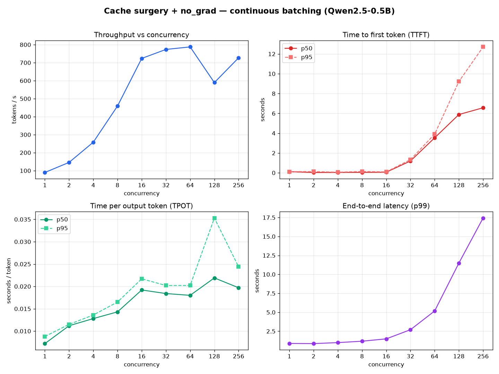
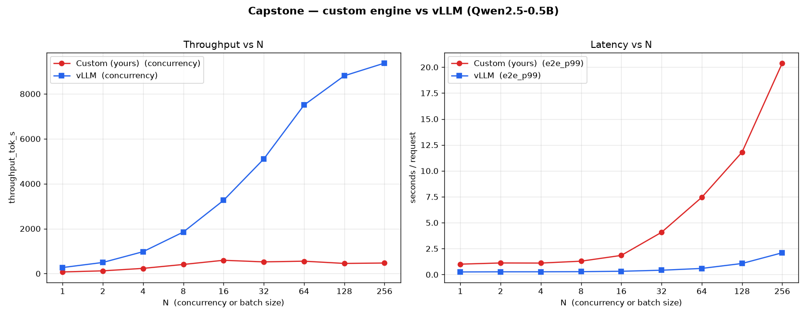

# Learning-Inference-Optimization

I am building an LLM inference server from scratch to learn how model serving works.
Each step adds one optimization to the server. I benchmark it and write down what I learned.

The server is a small FastAPI app (`main.py` + `app/`). It loads a HuggingFace language model and
has endpoints for text generation. Each step in my [plan](plan.md) changes how the server works
inside, and a benchmark board shows the effect of each change.

My goal is to understand why production engines like vLLM are designed the way they are. I build
a server without their features first, so I can see the problems those features solve.

## Summary

- **I built a continuous batching server from scratch.** It has a KV cache, static batching, a
  background engine that batches live requests together, admission control (a limit on how many
  requests it accepts), and code that adds and removes requests from the KV cache while it runs.
- **It reaches about 788 tokens/s on one 8 GB GPU** with Qwen2.5-0.5B. The time per output token
  stays at about 0.02 s for all load levels. When there is too much load, the server rejects the
  extra requests with HTTP 429. There were 0 errors up to 64 concurrent requests.
- **I compared it with vLLM. vLLM is about 12× faster at peak.** I can explain each part of this
  difference. vLLM uses PagedAttention, fused kernels and CUDA graphs, and my server does not.

The full list of steps and their status is in **[plan.md](plan.md)**. My detailed notes for each
step, including the bugs I found, are in **[PROGRESS.md](PROGRESS.md)**.

## Quickstart

```bash
uv venv .venv
source .venv/bin/activate
uv sync

python main.py            # serves on http://localhost:8000
```

> **Hardware note:** my GPU has about 8 GB of memory. I use small models with normal (softmax)
> attention, such as `Qwen/Qwen2.5-0.5B` or `gpt2`. 2B models do not fit. Linear-attention models
> also do not work here, because they do not have a normal KV cache that grows with each token.

## Results

All benchmarks below use **Qwen2.5-0.5B** with `max_length=64`. The benchmark is **closed-loop**:
each client sends a new request as soon as its last one finishes. I test different numbers of
concurrent clients. I measure four things:

- **TTFT** (time to first token): how long until the first word appears.
- **TPOT** (time per output token): how fast the rest of the text streams.
- **Throughput**: total tokens per second across all requests.
- **Tail latency**: the p95 and p99 total time for a request (the slowest 5% and 1%).

### Comparing all steps

`scripts/board.py` keeps a benchmark board in `benchmarks/board.json`. Each step adds its results
to the board. The `compare` command plots everything on the board, so new steps appear without
code changes. On the x-axis, N means the number of concurrent requests for steps 2, 4 and 8, and the
batch size for step 3.


The fair comparison is **step 2 vs step 4**, because both are tested with live concurrent requests.
Step 2 handles one request at a time. Its throughput stays at about 86 tokens/s, and its p99 latency
grows to about 12 s under load. **Step 4 (continuous batching) goes up to about 389 tokens/s and
stops growing at 16 concurrent requests**, which is its `batch_size`. Its time per token stays the
same for all load levels. The load is the same as step 2, but the requests now run together in one
batch.

Step 3 (static batching) reaches the highest number (about 1200 tokens/s), but it is not a fair
comparison. In step 3, N is the number of prompts in a single request, so the batch is always full
and there is no scheduling. I see it as the upper limit. Step 4 shows what I get with real,
separate requests.

The **Capstone: custom** line is the step 4 engine after two fixes (KV cache changes and `no_grad`,
explained below). It reaches **about 788 tokens/s**, which is much higher than my first step 4 version.

### Step 1: baseline

A simple loop with no KV cache, no batching and no engine. For every new token, the model processes
the whole text again. `/generate` does not stream, so TTFT and TPOT are both just the total time
divided by the number of tokens. Every later step should do better than this.

### Step 2: KV cache

Endpoint `/generate-stream`. Tested with 1 to 16 concurrent requests.


**Results:** TTFT drops to about 23 ms, because the prompt is processed only once. TPOT is about
18 ms per token with one request, so each step only computes the new token. But throughput stays at
about 60–83 tokens/s for all concurrency levels, and latency grows in a straight line with load. The
requests wait for each other, because only one forward pass runs at a time.

**What I learned:** the KV cache makes one request faster, but it does not help when many requests
come at once. Batching is needed for that.

### Step 3: static batching

Endpoint `/generate-batch`. It takes N prompts in one request. Tested with batch sizes 1 to 32.


**Results:** total throughput goes up about 12× (from 98 to 1204 tokens/s) from batch size 1 to 16.
The time for each request stays about 0.8 s. Each sequence gets about 72–77 tokens/s. Batch size 32
runs out of memory on my 8 GB GPU.

**What I learned:** generating tokens is limited by memory speed, not by compute. The GPU reads the
model weights once per step, no matter how many sequences are in the batch. So adding more
sequences costs very little, until memory runs out.

### Step 4: continuous batching

One background engine (`app/batching/engine.py`) puts live requests together into one batch. New
requests join the batch while it runs, and finished requests leave it. Endpoint
`/generate-continuous-batch`.


**Results:** throughput **goes up until 16 concurrent requests (the `batch_size`), reaching about
389 tokens/s, and then stays flat at about 383**. At that point the GPU is fully busy.
**TPOT stays about 0.02 s for all load levels, from 1 to 256 concurrent requests.** Once a request is
in the batch, each token costs the same. In step 2, TPOT grew 14× under load. TTFT is about 0.08 s
until 16 requests. After that it grows in a straight line, up to 25 s at 256 requests, because new
requests have to wait for a free place in the batch.

**What I learned:** after the batch is full, more load only adds waiting time. It does not add
throughput. So the best load for good latency is about the batch size. With only one request, this
engine is a little slower than step 2, because the engine has some extra work and there is no batch
to share it with.

> This plot is from my first version, which recomputed the whole batch every time the batch changed.
> Later I changed the engine to edit the KV cache directly and added `torch.no_grad()`. The results
> after these fixes are in the next section.

### Fixed engine: KV cache editing and `no_grad`

Two changes made the step 4 engine stable. Before them, it worked but used too much memory and did
extra work.

- **Editing the KV cache instead of recomputing it.** When new requests join, I process only the
  new prompts and add their KV cache to the existing one. To do this, I pad the shorter cache on
  the left and join them along the batch dimension. When a request finishes, I remove its row from
  the cache. Requests that are still running keep their cache, so I do not process the whole batch
  again each time a request joins or leaves. For this to work correctly, I had to calculate
  `position_ids` from the attention mask. Without this, a newly added request uses the wrong
  position for RoPE (the position encoding inside the model).
- **Adding `torch.no_grad()` to `forward` fixed the out-of-memory errors in all my earlier runs.**
  Without it, PyTorch saved data for gradients at every step. The KV cache is part of that saved
  data and is passed back into the model, so all the old data stayed in memory. GPU memory grew to
  about 7.6 GB with a 0.5B model. This bug took me the longest to find, and the fix was one line.



**Results:** peak throughput went from **about 389 to about 788 tokens/s**. Throughput now stops
growing at 32 to 64 requests instead of 16. There were **0 errors up to 64 concurrent requests**.
TPOT stays at about 0.02 s per token. TTFT and total latency are low until the batch is full, and
then they grow as requests wait. When the load is too high, admission control **rejects extra
requests with HTTP 429**. The drop in throughput at 128 requests is caused by these rejections, not
by the server getting stuck. This is the version I compared with vLLM.

### Capstone: my engine vs vLLM

I wanted to know how close I got to a production engine, so I ran vLLM on the same setup. I used
the same model (Qwen2.5-0.5B), the same prompts and the same measurements. Each server ran alone
on the 8 GB GPU, because vLLM takes about 90% of GPU memory and they cannot run together.



| metric | Mine | vLLM | difference |
|--------|------:|------:|----:|
| tokens/s with 1 request | 90 | 270 | 3.0× |
| peak tokens/s | 788 (at 64) | 9370 (at 256) | about 12× |
| TTFT p50 with 1 request | 114 ms | 9 ms | 13× |
| TPOT p95 with 1 request | 8.8 ms | 3.7 ms | 2.4× |
| errors at 256 requests | rejects with 429 | 0 | — |

**The size of the difference is not the main result. The main result is that I can explain where it
comes from:**

- **About 12× more throughput, and no rejected requests up to 256: PagedAttention.** vLLM stores the
  KV cache in small fixed-size blocks that do not need to be next to each other in memory. This
  means no wasted padding and no memory fragmentation, so it can fit hundreds of sequences in 8 GB.
  Its batch grows to 256 or more. My batch is limited to 16 sequences, and I reject extra requests.
  This limit is exactly the problem that PagedAttention solves.
- **About 2.4× lower TPOT: fused kernels, CUDA graphs and FlashAttention.** In vLLM, one generation
  step runs as a small number of combined GPU operations. My engine runs normal PyTorch, one
  operation at a time.
- **About 13× lower TTFT: faster prompt processing and a faster (C++) server code path.**

**My conclusion:** PagedAttention decides how many requests fit and how much throughput you get.
Fused kernels decide how fast each token is. With only Python and PyTorch, my engine is close to
its limit. The rest of the difference needs custom GPU kernels, which I do not cover in this repo
(see [plan.md](plan.md#out-of-scope)). Because I built a server without these features first, I now
understand why vLLM needs them.

## Running the benchmarks yourself

Every step uses the same process: run the benchmark, save the JSON file, plot it, and add it to the
board.

```bash
# 1. run (start the server in another terminal, or pass --load to load the model first)
python scripts/benchmark_endpoint.py --model Qwen/Qwen2.5-0.5B --load --endpoint <endpoint>

# 2. save the results and make the 4-panel plot
cp bench_endpoint_results.json benchmarks/step<N>_<name>.json
python scripts/plot_endpoint.py --results benchmarks/step<N>_<name>.json \
    --out benchmarks/step<N>_<name>.png --title "Step <N>: <name> (Qwen2.5-0.5B)"

# 3. add it to the board and update the comparison plot
python scripts/board.py add --step <N> --label "Step <N>: <name>" \
    --results benchmarks/step<N>_<name>.json
python scripts/board.py compare --out benchmarks/step_comparison.png
```

The script and endpoint for each step:

| step | script | result file |
|------|--------|-------------|
| 2: KV cache | `benchmark_endpoint.py --endpoint generate-stream` | `benchmarks/step2_kv_cache.json` |
| 3: static batching | `benchmark_batch.py --batch-sizes 1,2,4,8,16,32` | `benchmarks/step3_batching.json` |
| 4: continuous batching | `benchmark_endpoint.py --endpoint generate-continuous-batch` | `benchmarks/step4_continuous_batching.json` |
| 8: admission control | `benchmark_endpoint.py --endpoint generate-continuous-batch` | `benchmarks/step8_admission_control.json` |
| capstone: vLLM | `benchmark_vllm.py` (OpenAI-compatible) | `benchmarks/capstone_vllm.json` |

The capstone plot uses a separate board (`benchmarks/capstone.json`):

```bash
python scripts/board.py --board benchmarks/capstone.json compare \
    --out benchmarks/capstone_vllm_vs_custom.png --title "Capstone: custom engine vs vLLM"
```

To check that requests in the same batch do not mix up their outputs, I use
`scripts/check_contamination.py`. It sends different prompts at the same time and prints each answer.

## API reference

| Method | Path | Purpose |
|--------|------|---------|
| POST | `/load` | Load a model and start its batching engine |
| POST | `/unload` | Remove a loaded model from memory |
| GET  | `/models` | List the loaded models |
| POST | `/generate` | Generate text in one response (simple baseline) |
| POST | `/generate-stream` | Stream text token by token (KV cache) |
| POST | `/generate-batch` | Static batch: N prompts in one request |
| POST | `/generate-continuous-batch` | Send a request to the continuous batching engine (streams tokens) |
| GET  | `/engine-profile` | Timing for each operation, collected by the engine |
